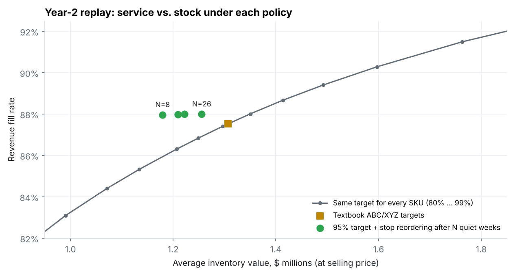
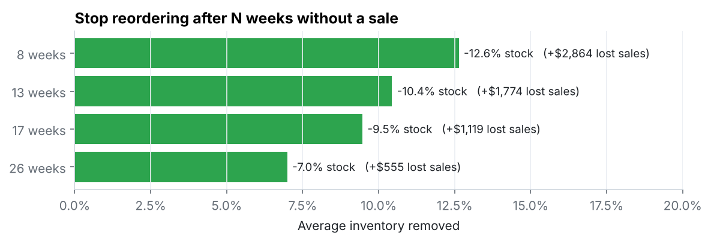
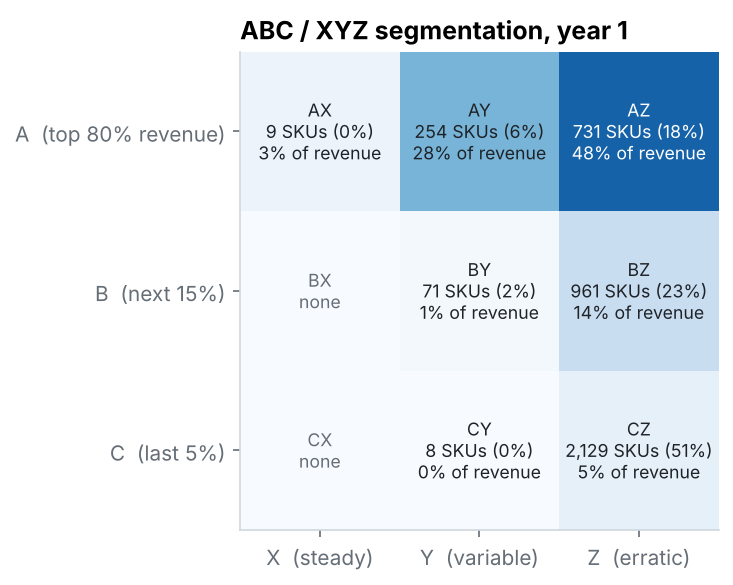
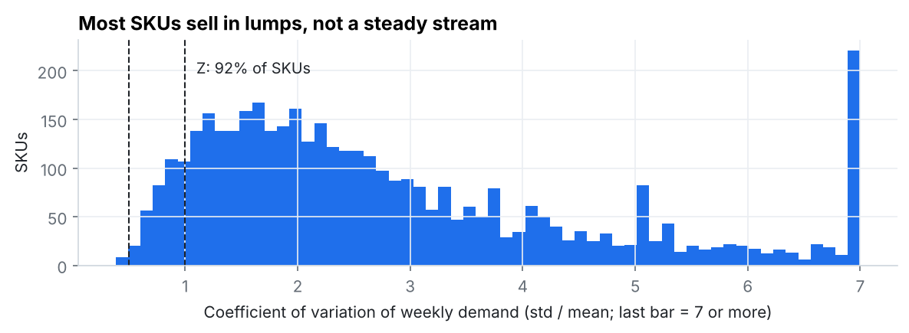
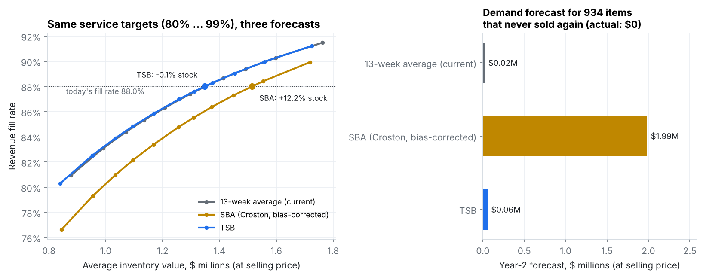

# Inventory Segmentation (ABC/XYZ) & Replenishment Policy Test

**Does textbook ABC/XYZ segmentation actually reduce inventory?** This project segments 4,163 SKUs from two years of real wholesale transactions. It then replays the second year week by week to compare service-level policies: one target for every SKU, textbook ABC/XYZ targets, data-optimized targets, and a simple rule for items that stop selling.

`SQL (DuckDB)` `Python` `pandas` `NumPy` `SciPy` `matplotlib` `Croston / SBA / TSB`

---

## Results

| Policy, replayed on year 2 | Inventory vs. a uniform target at the same fill rate |
|---|---|
| Textbook ABC/XYZ service targets | **−0.03%** over the full year (−1.2% on the second half) |
| Targets optimized per segment | −5.7% on the half it was tuned on, **+0.2%** on the half it wasn't |
| **Stop reordering after 8 weeks without a sale** | **−12.6%** stock for **$2,864** extra lost sales on $7.7M of demand |
| Croston-type forecast (SBA) on intermittent and lumpy SKUs | **+12.2%** (TSB, a variant that decays when sales stop: −0.1%) |



**Takeaways**
1. **Segmentation alone didn't move the needle.** Giving A items higher service targets and C items lower ones just shifts stock between segments. It's within about 1% of a flat 95% target at the same fill rate.
2. **Tuning targets from data overfit.** Targets fitted on December–May didn't hold up on June–November, a different season. A planner who'd reported the 5.7% "saving" would have been wrong.
3. **The real waste was items that had stopped selling.** 959 SKUs (23%) that sold in year 1 never sold again in year 2, yet a standard policy kept **16% of average inventory** on them. A dormancy rule cuts $171K of average stock (at selling price) and barely touches revenue: fill rate moves from 88.01% to 87.97%.
4. **The textbook intermittent-demand forecast made things worse.** Croston/SBA only updates in weeks with a sale, so it kept forecasting **$2.0M** of year-2 demand for 934 items that never sold again. It needed 12% more stock for the same fill rate. TSB fixes that flaw but only matches the 13-week average ([details](#forecasts-built-for-intermittent-demand)).



---

## Segmentation (year 1)

- **ABC** by revenue: A = SKUs making up the first 80% of revenue, B = the next 15%, C = the last 5%.
- **XYZ** by coefficient of variation (CV) of weekly demand: X ≤ 0.5 (steady), Y ≤ 1.0, Z > 1.0 (erratic).



A quarter of SKUs (24%) drive 80% of revenue. But the standard XYZ cutoffs put **92% of SKUs and 67% of revenue in Z**, and only 9 SKUs qualify as steady. This is a wholesaler whose customers order in batches, so most items sell in lumps with many zero weeks:



That's the main reason textbook targets struggle here: they assume most demand is reasonably smooth.

---

## Forecasts built for intermittent demand

XYZ by CV puts 92% of SKUs in one bucket. The Syntetos-Boylan scheme splits demand on two measures from year 1: how often an item sells (ADI, average weeks between sales; cut-off 1.32) and how much the order size varies when it does sell (CV² of the non-zero weeks; cut-off 0.49).

| Class | SKUs | Year-1 revenue | Typical item |
|---|---|---|---|
| Smooth | 134 (3%) | 16% | sells most weeks, steady size |
| Erratic | 736 (18%) | 40% | sells most weeks, size swings |
| Intermittent | 942 (23%) | 11% | sells about one week in 9, steady size |
| Lumpy | 2,351 (56%) | 33% | sells about one week in 3, size swings |

The 3,821 Z items break down as 544 erratic, 926 intermittent and 2,351 lumpy. That matters because the standard advice is to forecast intermittent and lumpy items with a Croston-type method.

**Test.** On the 3,293 intermittent and lumpy SKUs, the 13-week average is replaced by two such forecasts. Everything else in the replay stays the same (sigma, lead time, other SKUs), and each method is run across the same service targets and compared at today's 88.0% fill rate on the full year 2. The smoothing constant is fixed at 0.1; nothing is fitted.

- **SBA** (Croston with the Syntetos-Boylan bias correction) smooths order size and the interval between orders, updating both only when a sale happens.
- **TSB** (Teunter-Syntetos-Babai) smooths order size the same way but updates the probability of a sale every week, so its forecast fades when an item stops selling.

| Forecast on intermittent/lumpy SKUs | Stock vs today at the same fill rate | With the 8-week dormancy rule on top | Forecast for items that never sold again |
|---|---|---|---|
| 13-week average (today) | — | −12.4% | $0.02M |
| SBA | **+12.2%** | −10.5% | **$1.99M** |
| TSB | −0.1% | **−13.5%** | $0.06M |



**What happened with SBA.** Croston's method has no way to notice that an item has stopped selling, because it only updates when a sale happens. Here 934 of the 3,293 intermittent/lumpy items never sold in year 2, and SBA kept forecasting them at their old rate: $2.0M of demand that never came, against $3.6M of real demand on this group. At the same time it was 12% low on the items that kept selling, because a 0.1 smoothing constant reacts slowly. So it put stock on dead items and ran short on live ones. Every smoothing constant from 0.05 to 0.3 still needed more stock than today (+7% to +20%).

**TSB** decays toward zero on dead items, so it doesn't have that problem, but on live items it ends up close to a 13-week average: −4% to +4% stock across the same range of smoothing constants. Combined with the dormancy rule it adds about one point (−13.5% vs −12.4%), which is small next to the rule itself.

The practical read: on this catalogue, a plain rule for dead items does more than a better forecast, and a Croston-type forecast should not go live without an obsolescence check. (The −12.4% for the dormancy rule here is at exactly 88.01% fill; the −12.6% above is at the same 95% target, where fill is 87.97%.)

---

## How the replay works

| | |
|---|---|
| **Data** | 1,067,371 transaction lines, Dec 2009 – Dec 2011, UK online gift wholesaler ([source](data/README.md)) |
| **Split** | Year 1 (52 weeks) sets segments; year 2 (52 weeks) is replayed. Targets are fitted on its first 26 weeks and tested on the last 26 |
| **Policy** | Weekly review, 2-week lead time, order up to 3 × forecast + safety stock |
| **Forecast / variability** | Trailing 13-week average; trailing 52-week standard deviation. Recomputed every week from past data only |
| **Outcome** | Lost sales when out of stock; revenue fill rate = sales value ÷ demand value |
| **SKUs included** | All 4,163 segmented in year 1, including ones that later stopped selling, since a planner can't know in advance |

The **dormancy rule** sets a SKU's order-up-to level to zero once it has had no sales for N weeks, and restarts it when it sells again. Stock already on hand stays until sold. All four values of N are shown; none was chosen by looking at results.

---

## Data cleaning worth knowing about

- **Duplicated week.** The source was built by stacking two yearly files that overlap on 1–9 December 2010. Every row in that window appears twice (elsewhere only 2% of rows have an exact twin), so the SQL keeps one copy ([`sql/02_clean_sales.sql`](sql/02_clean_sales.sql)).
- **Cancellations are netted, not deleted.** One 80,995-unit order was cancelled the same day. Dropping only the cancellation line would have left a phantom order that dwarfs a year of normal demand.
- Postage, fees and manual adjustments (non-product codes) are excluded.

## Limits

- No cost data, so inventory is valued at selling price. Percentage comparisons hold; dollar figures overstate inventory at cost.
- Normal-distribution safety stock is a poor fit for lumpy demand. Croston-type forecasts are tested above; sizing safety stock from empirical demand-over-lead-time quantiles is the remaining test.
- Lead time is assumed fixed at 2 weeks, with no order minimums or case packs.

---

## Running it

```bash
pip install -r requirements.txt
# put online_retail_II.csv in data/raw/ (see data/README.md)
python run_all.py
```

A full run takes a few seconds and regenerates all outputs; console output is in [`outputs/run_log.txt`](outputs/run_log.txt).

```
sql/
  01_quality_checks.sql    coverage, the duplicated overlap week, non-product codes
  02_clean_sales.sql       de-duplicate the overlap, product codes only, cancellations as negatives
  03_weekly_demand.sql     complete SKU x week grid of net demand; SKU unit value
  04_segmentation.sql      ABC by cumulative revenue, XYZ by CV, segment matrix
src/
  data.py                  loads the CSV into DuckDB, runs the SQL
  inventory.py             week-by-week replenishment replay
  optimize.py              uniform vs textbook vs optimized targets; dormancy rule
  intermittent.py          Syntetos-Boylan classes; SBA and TSB forecasts in the same replay
  charts.py
outputs/
  summary.csv  policy_comparison.csv  dormancy_rule.csv  targets_by_segment.csv
  segment_matrix.csv  sku_segments.csv  uniform_tradeoff.csv
  demand_classes.csv  intermittent_comparison.csv  intermittent_tradeoff.csv
  intermittent_accuracy.csv  intermittent_sensitivity.csv
```
