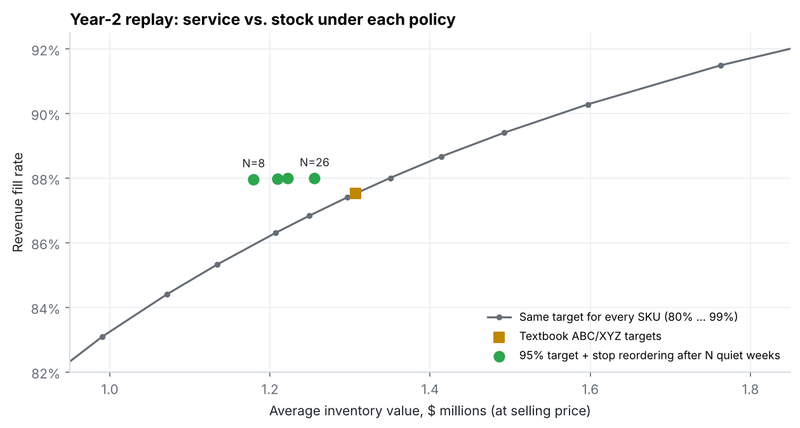
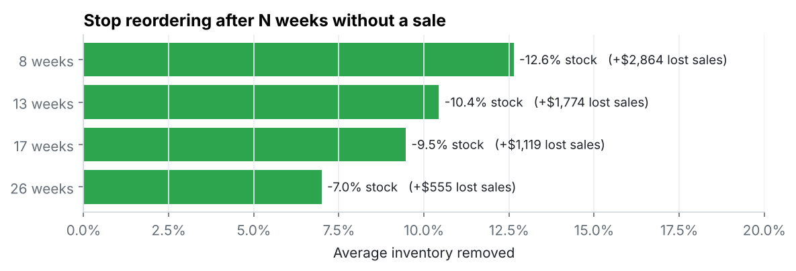
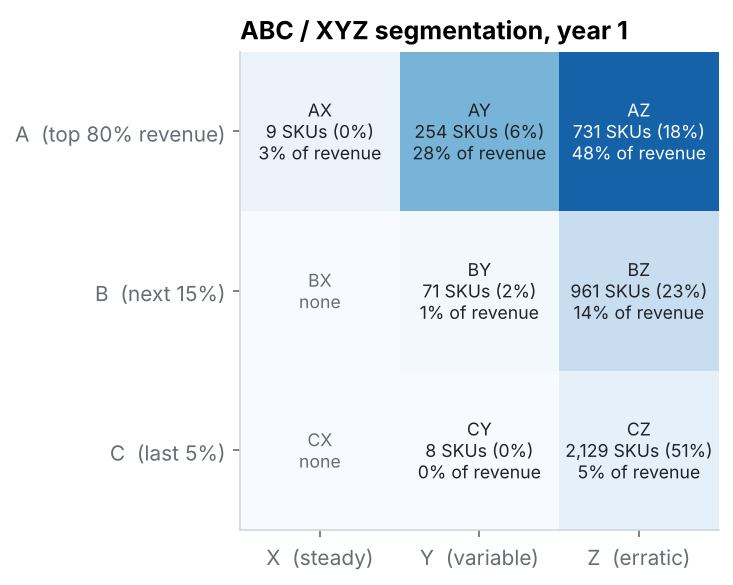
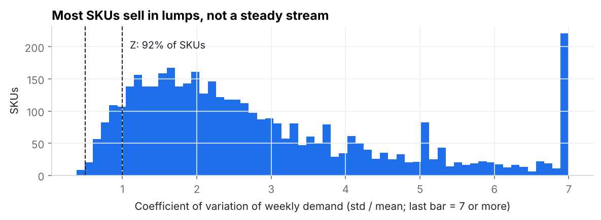

# Inventory Segmentation (ABC/XYZ) & Replenishment Policy Test

**Does textbook ABC/XYZ segmentation actually reduce inventory?** This project segments 4,163 SKUs from two years of real wholesale transactions. It then replays the second year week by week to compare service-level policies: one target for every SKU, textbook ABC/XYZ targets, data-optimized targets, and a simple rule for items that stop selling.

`SQL (DuckDB)` `Python` `pandas` `NumPy` `SciPy` `matplotlib`

---

## Result

| Policy, replayed on year 2 | Inventory vs. a uniform target at the same fill rate |
|---|---|
| Textbook ABC/XYZ service targets | **−0.03%** over the full year (−1.2% on the second half) |
| Targets optimized per segment | −5.7% on the half it was tuned on, **+0.2%** on the half it wasn't |
| **Stop reordering after 8 weeks without a sale** | **−12.6%** stock for **$2,864** extra lost sales on $7.7M of demand |



**What this means for a planner**
1. **Segmentation alone didn't move the needle.** Giving A items higher service targets and C items lower ones just shifts stock between segments. It's within about 1% of a flat 95% target at the same fill rate.
2. **Tuning targets from data overfit.** Targets fitted on December–May didn't hold up on June–November, a different season. A planner who'd reported the 5.7% "saving" would have been wrong.
3. **The real waste was items that had stopped selling.** 959 SKUs (23%) that sold in year 1 never sold again in year 2, yet a standard policy kept **16% of average inventory** on them. A dormancy rule cuts $171K of average stock (at selling price) and barely touches revenue: fill rate moves from 88.01% to 87.97%.



---

## Segmentation (year 1)

- **ABC** by revenue: A = SKUs making up the first 80% of revenue, B = the next 15%, C = the last 5%.
- **XYZ** by coefficient of variation (CV) of weekly demand: X ≤ 0.5 (steady), Y ≤ 1.0, Z > 1.0 (erratic).



A quarter of SKUs (24%) drive 80% of revenue. But the standard XYZ cutoffs put **92% of SKUs and 67% of revenue in Z**, and only 9 SKUs qualify as steady. This is a wholesaler whose customers order in batches, so most items sell in lumps with many zero weeks:



That's the main reason textbook targets struggle here: they assume most demand is reasonably smooth.

---

## How the replay works

| | |
|---|---|
| **Data** | 1,067,371 transaction lines, Dec 2009 – Dec 2011, UK online gift wholesaler ([source](data/README.md)) |
| **Split** | Year 1 (52 weeks) sets segments; year 2 (52 weeks) is replayed. Targets are fitted on its first 26 weeks and tested on the last 26 |
| **Policy** | Weekly review, 2-week lead time, order up to 3 × forecast + safety stock |
| **Forecast / variability** | Trailing 13-week average; trailing 52-week standard deviation. Recomputed every week from past data only |
| **Outcome** | Lost sales when out of stock; revenue fill rate = sales value ÷ demand value |
| **SKUs included** | All 4,163 segmented in year 1, including ones that later stopped selling, since a planner can't know in advance |

The **dormancy rule** sets a SKU's order-up-to level to zero once it has had no sales for N weeks, and restarts it when it sells again. Stock already on hand stays until sold. All four values of N are shown; none was chosen by looking at results.

---

## Data cleaning worth knowing about

- **Duplicated week.** The source was built by stacking two yearly files that overlap on 1–9 December 2010. Every row in that window appears twice (elsewhere only 2% of rows have an exact twin), so the SQL keeps one copy ([`sql/02_clean_sales.sql`](sql/02_clean_sales.sql)).
- **Cancellations are netted, not deleted.** One 80,995-unit order was cancelled the same day. Dropping only the cancellation line would have left a phantom order that dwarfs a year of normal demand.
- Postage, fees and manual adjustments (non-product codes) are excluded.

## Limits

- No cost data, so inventory is valued at selling price. Percentage comparisons hold; dollar figures overstate inventory at cost.
- Normal-distribution safety stock is a poor fit for lumpy demand. A method built for intermittent demand (e.g. Croston-type forecasts, or empirical demand-over-lead-time quantiles) is the logical next test.
- Lead time is assumed fixed at 2 weeks, with no order minimums or case packs.

---

## Run it

```bash
pip install -r requirements.txt
# put online_retail_II.csv in data/raw/ (see data/README.md)
python run_all.py
```

Runs in a few seconds and rebuilds every number and chart; console output is in [`outputs/run_log.txt`](outputs/run_log.txt).

```
sql/
  01_quality_checks.sql    coverage, the duplicated overlap week, non-product codes
  02_clean_sales.sql       de-duplicate the overlap, product codes only, cancellations as negatives
  03_weekly_demand.sql     complete SKU x week grid of net demand; SKU unit value
  04_segmentation.sql      ABC by cumulative revenue, XYZ by CV, segment matrix
src/
  data.py                  loads the CSV into DuckDB, runs the SQL
  inventory.py             week-by-week replenishment replay
  optimize.py              uniform vs textbook vs optimized targets; dormancy rule
  charts.py
outputs/
  summary.csv  policy_comparison.csv  dormancy_rule.csv  targets_by_segment.csv
  segment_matrix.csv  sku_segments.csv  uniform_tradeoff.csv
```
